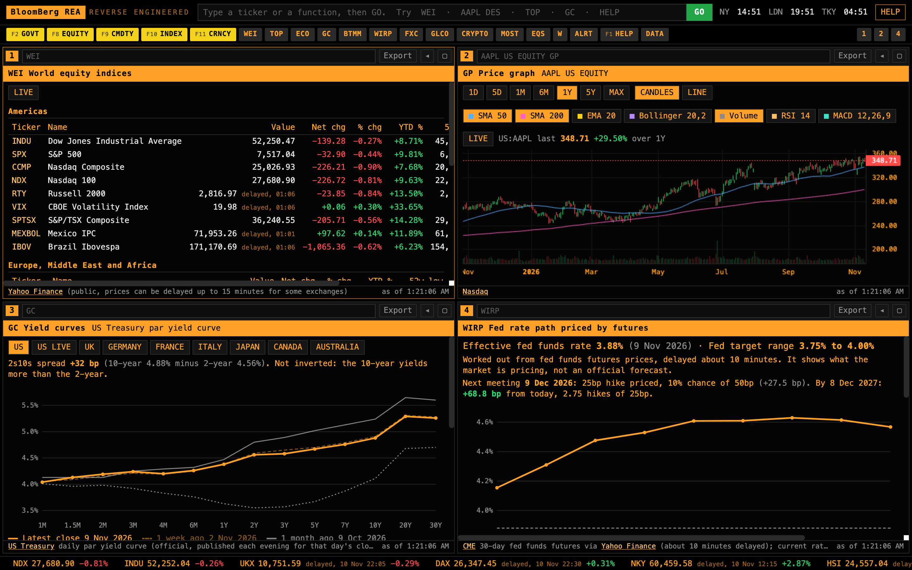
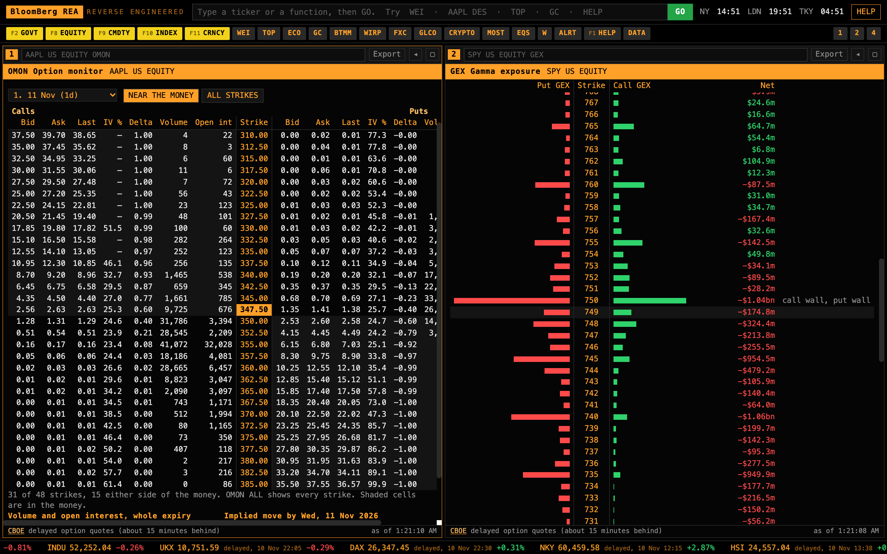
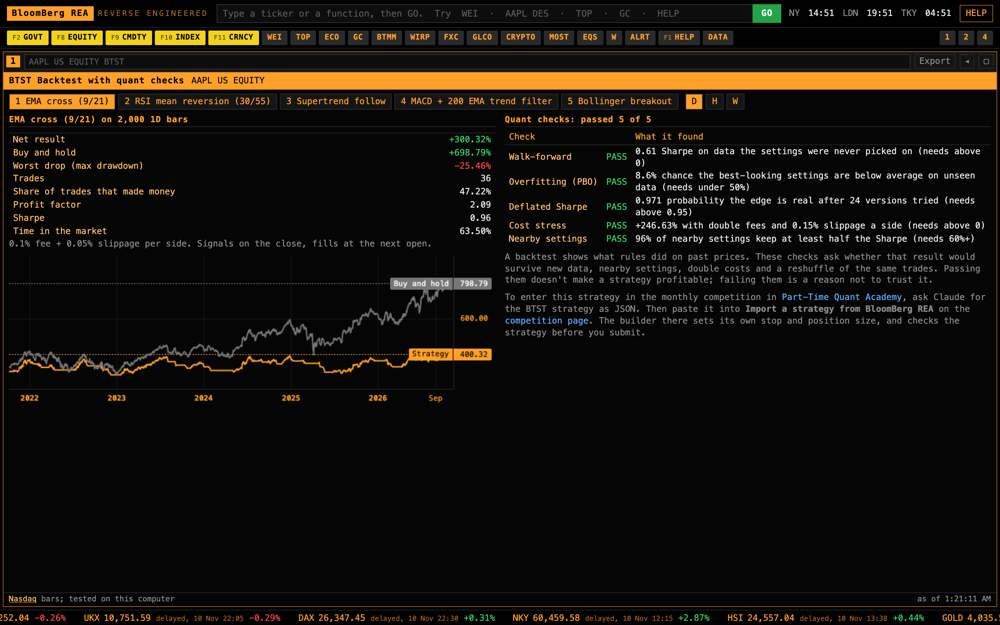
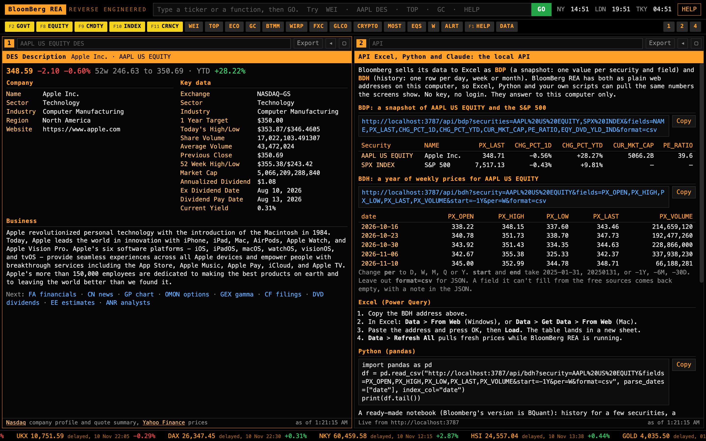
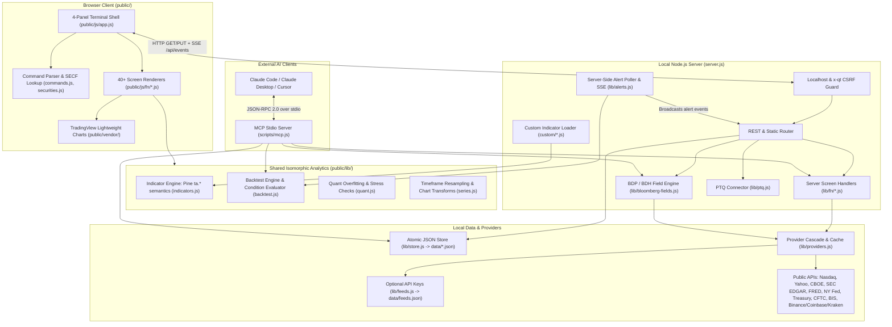
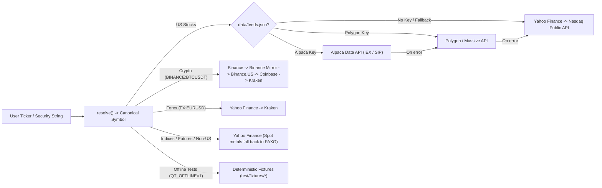

# BloomBerg Reverse Engineered (BloomBerg REA)

> A free, zero-dependency, Bloomberg-style market terminal that runs locally on your machine using public market data—with a 4-panel keyboard-driven UI, 40+ financial screens, options & gamma exposure analytics, a look-ahead-free strategy backtester with quant overfitting checks, local Excel/Python `BDP`/`BDH` APIs, and a built-in MCP server for AI assistants.



---

## Table of Contents

- [Highlights](#highlights)
- [Screenshots](#screenshots)
- [Architecture](#architecture)
  - [System Overview](#system-overview)
  - [Data Resolution & Fallback Chains](#data-resolution--fallback-chains)
  - [Module & Directory Layout](#module--directory-layout)
  - [Security & Persistence Model](#security--persistence-model)
- [Quick Start](#quick-start)
- [Using the Terminal](#using-the-terminal)
  - [Command Grammar & Aliases](#command-grammar--aliases)
  - [Keyboard Shortcuts & Yellow Keys](#keyboard-shortcuts--yellow-keys)
- [Function Code Reference](#function-code-reference)
- [Backtester (`BTST`), Indicators & Quant Checks](#backtester-btst-indicators--quant-checks)
- [Local API (`BDP`, `BDH`, REST & SSE)](#local-api-bdp-bdh-rest--sse)
- [AI Integration via MCP (`ASK`)](#ai-integration-via-mcp-ask)
- [Optional Custom Data Feeds & Extensions](#optional-custom-data-feeds--extensions)
- [Testing & Diagnostics](#testing--diagnostics)
- [Limitations & Credits](#limitations--credits)

---

## Highlights

- **Zero dependencies, zero build step:** Pure Node.js (`>=18`) backend and native ES-module browser frontend (`public/`). No `npm install`, no bundler, no API keys required out of the box.
- **4-Panel Workspace (`LAYOUT 1 | 2 | 4`):** Independent command lines, navigation history (`Esc` to go back), per-panel CSV export, world market clocks (NY / LDN / TKY), yellow asset-class keys, `SECF`-style autocomplete, and a scrolling global ticker tape.
- **40+ Institutional-Style Screens:** Global equity indices (`WEI`), yields & curves (`GC`, `BTMM`, `WIRP`), credit spreads (`CRED`), Treasury auctions (`AUCT`), options chains (`OMON`), gamma exposure (`GEX`), volatility surface (`OVDV`), SEC EDGAR filings & full-text search (`CF`, `DS`, `INSD`), company fundamentals (`DES`, `FA`, `EE`, `ANR`, `DVD`, `HDS`), macro series (`ECO`, `ECST`, `SURP`, `CBRT`, `COT`), and portfolio/watchlist tools (`W`, `PORT`, `ALRT`).
- **Look-Ahead-Free Backtester & Quant Validation (`BTST`):** Signal evaluation on bar close with next-bar-open or limit-order fills, bid-ask spread and intrabar stop modeling, plus 5 institutional quant checks (Walk-Forward, CSCV Probability of Backtest Overfitting, Probabilistic/Deflated Sharpe Ratio, Cost Stress, and Parameter Robustness).
- **Bloomberg-Compatible Local Data Endpoints (`BDP` & `BDH`):** Query snapshots and historical OHLCV bars directly from Excel Power Query or Python `pandas` (`examples/quickstart.ipynb`).
- **Native MCP Server (`scripts/mcp.js`):** Connects Claude Code, Claude Desktop, or Cursor directly to all terminal functions, quotes, history, backtests, watchlists, and alerts.

---

## Screenshots

### Options Monitor (`OMON`) & Gamma Exposure (`GEX`)
Inspect live delayed CBOE option chains (calls/puts, IV, Greeks, volume/OI, implied earnings/event move) side-by-side with dealer Gamma Exposure by strike, call/put walls, and net GEX profile.



### Strategy Backtester (`BTST`) & Quantitative Checks
Test preset or custom JSON strategies across daily, hourly, or weekly bars with equity curves vs. buy-and-hold and automated overfitting/robustness diagnostics.



### Company Description (`DES`) & Local `BDP` / `BDH` API Screen (`API`)
Drill into company profiles and key valuation stats while generating ready-to-copy `BDP`/`BDH` CSV URLs, Excel Power Query instructions, `pandas` snippets, and MCP setup commands.



---

## Architecture

### System Overview

BloomBerg REA is structured around a lightweight local Node.js HTTP/SSE server (`server.js`), modular public-data screen providers (`lib/fn/*`), a shared client/server technical analysis and backtesting engine (`public/lib/*`), local JSON persistence (`lib/store.js`), and an optional standalone stdio MCP server (`scripts/mcp.js`) that shares the exact same data and analytics modules.



### Data Resolution & Fallback Chains

Security strings (e.g., `AAPL US EQUITY`, `VOD LN`, `SPX INDEX`, `CL1 COMDTY`, `EURUSD CURNCY`, `BTC`) are normalized into canonical `EXCHANGE:TICKER` identifiers (`resolve()` in `lib/providers.js`). Market data fetches automatically cascade across multiple providers, tracking host availability (`hostDownUntil`) and caching responses in memory so single-source rate limits or timeouts fall back transparently:



### Module & Directory Layout

| Path | Role |
|---|---|
| `server.js` | HTTP/SSE server, localhost security guard, `/api/*` router, `/api/fn/*` dynamic loader, `/custom/*.js` indicator hot-loader, static asset serving |
| `lib/providers.js` | Security symbol resolver, multi-provider candle/quote cascades, Nasdaq/crypto screeners, economic calendar, provider health probes |
| `lib/feeds.js` | Optional user-supplied Alpaca & Polygon (`Massive`) key integration read dynamically from `data/feeds.json` |
| `lib/bloomberg-fields.js` | `BDP` snapshot and `BDH` historical field engine, CSV/JSON serialization, relative date parsing (`-1Y`, `-6M`, `-30D`), MCP install command generator |
| `lib/market-info.js` | Earnings/dividend calendars, RSS/Nasdaq company news, and Nasdaq financial statement adapters |
| `lib/alerts.js` | Background 15-second alert evaluator supporting up to 5 multi-conditions (`all`/`any`), `once` / `oncePerBar` / `oncePerBarClose` triggers, SSE push, and webhook POSTs |
| `lib/store.js` | Atomic JSON persistence in `data/` (temp-file + rename with Windows fallback) |
| `lib/ptq.js` | Optional connector to Part-Time Quant (`PTQ_URL`, default `127.0.0.1:8787`) for strategy verification and fail-safe kill-switch/disarm controls |
| `lib/proxy.js` | Automatic corporate/local HTTP(S) proxy environment detection & relaunch helper |
| `lib/fn/*.js` | 31 backend data adapters serving `/api/fn/<name>` (e.g., `wirp.js`, `gc.js`, `omon.js`, `gex.js`, `cf.js`, `ds.js`, `des.js`, `cot.js`, `cred.js`, `auct.js`, `ovdv.js`, `eq-port.js`) |
| `public/index.html` & `public/css/terminal.css` | Terminal shell, amber-on-black theme, responsive grid (`LAYOUT 1`, `2`, `4`) |
| `public/js/app.js` | 4-panel workspace controller, active-panel focus, command history stack (`Esc`), `SECF` autocomplete dropdown, live clocks, ticker tape, SSE notification listener |
| `public/js/commands.js` & `public/js/securities.js` | Command-line tokenizer supporting `<security> <fn> [args]` and `<fn> <security> [args]`, yellow-key parsing, index/commodity generic maps |
| `public/js/ui.js` | Shared DOM helpers: sortable tables, TradingView chart wrappers, CSV export, live-switch toggle |
| `public/js/fn/*.js` | 15 modular UI screen groups registered via `public/js/fn/index.js` |
| `public/lib/*.js` | Isomorphic calculation engine shared across browser, Node server, alerts, and tests (`indicators.js`, `backtest.js`, `quant.js`, `series.js`, `seasonals.js`) |
| `scripts/` | CLI utilities: `launch.js`, `stop.js`, `check.js`, `doctor.js`, `smoke.js`, `test.js`, `setup.js`, `compare.js`, `mcp.js` |
| `custom/` | User-authored JavaScript indicator modules automatically registered as `custom:<slug>` |
| `examples/quickstart.ipynb` | Python `pandas` & `matplotlib` notebook demonstrating `/api/bdh`, `/api/bdp`, `/api/fn/wirp`, and `/api/fn/gc` |
| `test/` | Offline unit/integration suites + deterministic JSON/CSV/XML fixtures + live smoke tests |

### Security & Persistence Model

- **Localhost-only access:** `allowed(req)` in `server.js` validates the `Host` header against `localhost`, `127.0.0.1`, `::1` (plus configured LAN addresses only if `HOST` is explicitly overridden). Requests with unexpected hosts receive `403 Forbidden`.
- **Cross-site write protection (CSRF):** Every non-`GET`/`HEAD` request (`PUT /api/state`, `POST /api/alerts`, `POST /api/scan`, `POST /api/custom`, `POST /api/shutdown`, etc.) requires both `x-qt: 1` and a same-host `Origin` header when present, preventing arbitrary websites from driving your local terminal.
- **Static path confinement:** `serveStatic()` normalizes paths and checks `baseDir + path.sep` prefixes to block directory traversal.
- **Local-first state (`data/`):** Saved layouts, watchlists, portfolios, alerts, and custom data keys reside strictly in `data/*.json` (ignored by `.gitignore`). Writes use atomic temporary files (`*.<pid>.tmp`) before renaming.

---

## Quick Start

### Prerequisites
- **Node.js 18 or newer** (tested on Node 18, 20, 22, 24, and 26). No `npm install` or build step is needed.

### 1. Verify Installation & Data Sources
Run the all-in-one check (runs 378 offline tests, probes live data sources, and runs an end-to-end live server smoke test):

```bash
node scripts/check.js
```

### 2. Optional: Configure Initial 4-Panel Profile
Set up your default 4 panels for a specific asset focus before launching:

```bash
node scripts/setup.js --profile stocks --ticker NVDA
# Profiles: stocks | crypto | fx | macro | mix
```

### 3. Launch & Stop
Start the server in the background and open your default browser (`http://localhost:3787`, or the next free port up to `+20`):

```bash
node scripts/launch.js
```

Alternative launch/stop commands:

| Platform / Action | Command |
|---|---|
| Foreground + open browser | `npm start` or `node server.js --open` |
| Foreground (headless) | `npm run serve` or `node server.js` |
| Custom port | `PORT=4000 node server.js` |
| Mac double-click launcher | `./start.command` |
| Linux / macOS shell | `./start.sh` |
| Windows double-click | `start.bat` |
| Stop background server | `node scripts/stop.js` (or `npm run stop`; add `--all` for all local copies) |

---

## Using the Terminal

### Command Grammar & Aliases

Each panel has its own command bar, and the global bar at the top executes in the currently active panel:

| Example Command | Behavior |
|---|---|
| `AAPL US EQUITY DES` or `AAPL DES` | Company description & key metrics for Apple |
| `VOD LN DES` | Vodafone in London (supports exchange codes like `LN`, `GR`, `FP`, `JP`, `HK`, `CN`, `AU`, etc.) |
| `SPX INDEX GP` | S&P 500 daily candlestick chart (`INDU`, `CCMP`, `NDX`, `UKX`, `DAX`, `NKY`, `HSI`, etc.) |
| `CL1 COMDTY GP` | Front-month WTI crude (`GC1` gold, `SI1` silver, `NG1` natural gas, `ES1`, `NQ1`, `TY1`, etc.) |
| `EURUSD CURNCY GP` | Euro / US Dollar FX chart |
| `BTC GP` or `BTC` | Bitcoin chart (`GP` is default for non-equities; `DES` is default for equities) |
| `NVDA OMON` or `OMON NVDA` | Function-first or security-first syntax both work |
| `QQQ CHART` / `QQQ GRAPH` | Command aliases (`CHART`, `GRAPH`, `PRICE` resolve to `GP`) |
| `WEI`, `TOP`, `ECO`, `WIRP`, `GC` | Market-wide screens (no security required) |
| `LAYOUT 1` / `LAYOUT 2` / `LAYOUT 4` | Switch grid between 1, 2, or 4 visible panels |

### Keyboard Shortcuts & Yellow Keys

| Key | Action |
|---|---|
| `Enter` (`GO`) | Execute command in the active/focused panel |
| `Esc` | Close autocomplete suggestions, or navigate back in panel history |
| `Ctrl + 1..4` / `Cmd + 1..4` | Focus Panel 1, 2, 3, or 4 |
| `/` | Jump cursor to the global top command bar |
| `Tab` / `↑` / `↓` | Navigate and accept `SECF` security/function autocomplete |
| `F1` | Open `HELP` (full interactive function directory) |
| `F2` | Insert `GOVT` yellow key |
| `F8` | Insert `EQUITY` yellow key |
| `F9` | Insert `CMDTY` yellow key |
| `F10` | Insert `INDEX` yellow key |
| `F11` | Insert `CRNCY` yellow key |

---

## Function Code Reference

### Markets
| Code | Name | Description & Primary Source |
|---|---|---|
| `WEI` | World equity indices | Global Americas/EMEA/APAC index levels, changes, YTD, 52w range (Yahoo Finance) |
| `GLCO` | Commodities | Energy, metals, and agriculture futures boards (Yahoo Finance) |
| `FXC` | Currency cross rates | G10 & major FX cross-rate matrix (Yahoo Finance / Kraken) |
| `CRYPTO` | Crypto monitor | Top crypto spot prices, 24h changes, volume (Binance / Coinbase / Kraken) |
| `CT` | Futures curve | Multi-month commodity & financial term structure, contango/backwardation spread (Yahoo contract strips) |

### Equities, Filings & Options
| Code | Name | Description & Primary Source |
|---|---|---|
| `DES` | Description | Company profile, sector/industry, target price, market cap, dividend stats |
| `BQ` | Quote | Live/delayed quote with pre-market and after-hours prints, bid/ask, 52w & YTD stats |
| `FA` | Financial analysis | Income statement, balance sheet, cash flow, and ratios (`FA Q` / `FA A`) |
| `MOST` | Most active US stocks | Most active, top gainers, and top losers (`MOST GAINERS`, `MOST LOSERS`) |
| `EQS` | Equity screener | Filterable US-listed stock screener (Nasdaq screener universe) |
| `ERN` | Earnings calendar | Upcoming company earnings dates, timing (BMO/AMC), consensus EPS |
| `DVD` | Dividends | Ex-dividend dates, payout history, annualized yield |
| `EE` | Earnings estimates | Consensus EPS forecasts and historical surprises (Zacks via Nasdaq) |
| `ANR` | Analyst ratings | Buy / Hold / Sell consensus breakdown and target prices |
| `CF` | Company filings | Latest SEC filings (`10-K`, `10-Q`, `8-K`, `4`) via SEC EDGAR submissions & Nasdaq |
| `DS` | Document search | Full-text search across SEC EDGAR 10-K/10-Q/8-K filings (`DS` with ticker or keyword phrase) |
| `INSD` | Insider transactions | Form 4 open-market buys & sells by executives and directors (SEC EDGAR) |
| `HDS` | Holders | Top institutional & mutual fund shareholders (Nasdaq / Yahoo) |
| `OMON` | Option monitor | Full call/put option chain with IV, Delta, Volume, Open Interest, P/C ratios, and implied move |
| `GEX` | Gamma exposure | Net dealer Gamma Exposure (`GEX`) by strike, call wall, put wall, and gamma flip level |
| `OVDV` | Volatility surface | Term structure and moneyness/25-delta skew volatility surface (`OVDV`, VIX term structure) |

### Rates & Economics
| Code | Name | Description & Primary Source |
|---|---|---|
| `GC` | Yield curves | US Treasury par yield curve (1M–30Y vs. 1W & 1M ago), 2s10s spread, plus UK/DE/FR/IT/JP/CA/AU curves |
| `BTMM` | US money markets | Effective Fed Funds (`EFFR`), `SOFR`, Treasury bills, and Fed target range (NY Fed & US Treasury) |
| `WIRP` | Fed rate path | Implied FOMC meeting probabilities, expected bps per meeting, and cumulative hike/cut path from 30-day Fed Funds futures |
| `CRED` | Credit spreads | ICE BofA US High Yield & Investment Grade OAS spreads, 1W changes, 1-year percentile (FRED) |
| `AUCT` | Treasury auctions | Upcoming & recent US Treasury bill/note/bond auction results and high rates (TreasuryDirect) |
| `CBRT` | Central bank rates | Global central bank policy rates and history (BIS `cbpol` dataset) |
| `ECO` | Economic calendar | Scheduled global macroeconomic releases, consensus vs. actual, impact level |
| `ECST` | US economic statistics | Key US macro series (`CPI`, `PAYEMS`, `UNRATE`, etc.) with interactive historical charts (FRED) |
| `SURP` | Economic surprises | Historical CPI, payrolls, and retail sales surprises alongside same-day S&P 500 & 10Y yield moves |
| `COT` | Commitments of traders | CFTC Disaggregated & Traders in Financial Futures net positioning (`COT GOLD`, etc.) |

### Charts, News, Workspace, Strategy & Help
| Code | Name | Description |
|---|---|---|
| `GP` / `GIP` / `HP` | Price graph / Intraday / History | Interactive candlestick/line charts (`1D`–`MAX`, overlays `SMA50`, `SMA200`, `EMA20`, `BB`, `VOL`, `RSI`, `MACD`) and tabular history |
| `COMP` | Compare returns | Rebase up to 6 securities to 100 to compare return, volatility, and drawdown (`COMP AAPL MSFT NVDA`) |
| `TOP` / `CN` | Top news / Company news | Market-wide headlines (`TOP TECH`, `TOP CRYPTO`, `TOP ECON`) and single-company news feeds |
| `W` | Watchlist monitor | Multi-list saved watchlists with live quotes, delay badges, and drag/edit support |
| `PORT` | Portfolio | Holdings valuation (`P&L`, daily change, weights, S&P 500 beta) + CSV import (Fidelity, Schwab, IBKR) |
| `ALRT` | Price & indicator alerts | Create/manage persistent server-side multi-condition alerts with browser notifications & webhooks |
| `BTST` | Backtest with quant checks | Interactive strategy tester with preset strategies, custom JSON rules, and 5 quant validation checks |
| `API` | Local API screen | Live `BDP`/`BDH` examples, Excel Power Query setup, Python snippet, and active port info |
| `ASK` | Ask Claude (MCP) | One-click MCP setup command and prompt guide for Claude Code / Desktop / Cursor |
| `PLAY` | AI Playbooks | Curated institutional research and feature-builder prompts for use with MCP |
| `HELP` / `DATA` | Directory & Data Sources | Interactive command list and real-time freshness/source audit table |

---

## Backtester (`BTST`), Indicators & Quant Checks

The shared engine in `public/lib/` guarantees identical indicator and execution behavior whether run in the browser (`BTST`), via MCP (`backtest`), or in background alerts (`lib/alerts.js`):

1. **Technical Indicators (`public/lib/indicators.js`):**
   - Follows TradingView Pine Script (`ta.*`) semantics—including RMA-seeded RSI/ATR/ADX, SMA-seeded EMA, population standard deviation, Anchored VWAP, Ichimoku/Supertrend/Alligator, Pivots, Fractals, ZigZag, Connors RSI, Rank Correlation Index, Chande Kroll Stop, and Markov regime classification.
2. **Execution Realism (`public/lib/backtest.js`):**
   - Signals are evaluated strictly at **bar close** and executed at the **next bar's open** (or via configurable `entryLimit` orders waiting `validBars`).
   - Supports long/short entries, `exitMatch: "all" | "any"`, `maxBarsInTrade`, stop-loss, take-profit, trailing stops, bid/ask `spreadPct` modeling, and configurable intrabar stop/target resolution (`worst`, `tv`, or finer-timeframe `magnifier`).
3. **Quant Overfitting Checks (`public/lib/quant.js`):**
   - **Walk-Forward Validation:** In-sample parameter selection evaluated strictly on out-of-sample segments.
   - **Probability of Backtest Overfitting (PBO):** Combinatorially Symmetric Cross-Validation (CSCV) across strategy variants.
   - **Probabilistic & Deflated Sharpe Ratio (DSR):** Adjusts Sharpe for return skewness, kurtosis (fat tails), and multiple-testing trials.
   - **Cost Stress Test:** Re-runs with `2x` fees and `3x` slippage (minimum `0.05%` per side).
   - **Parameter Robustness & Monte Carlo:** Checks neighboring parameter stability and trade-order reshuffling distributions.
4. **PTQ Connector (`lib/ptq.js`):**
   - If you run a local Part-Time Quant (`PTQ`) runtime (`http://127.0.0.1:8787`), `/api/ptq/*` exposes status, strategy validation checks, and fail-safe kill-switch / disarm controls without ever arming live orders from the terminal.

---

## Local API (`BDP`, `BDH`, REST & SSE)

While BloomBerg REA is running locally, all endpoints answer on `http://localhost:3787` (read-only `GET` endpoints require no special headers):

### Bloomberg-Compatible Excel / Python Endpoints

- **`GET /api/bdp`** — Snapshot fields across one or more securities:
  ```text
  http://localhost:3787/api/bdp?securities=AAPL%20US%20EQUITY,SPX%20INDEX&fields=NAME,PX_LAST,CHG_PCT_1D,CUR_MKT_CAP,PE_RATIO&format=csv
  ```
- **`GET /api/bdh`** — Historical bars (`per=D|W|M|Q|Y`, `start`/`end` as `YYYY-MM-DD`, `YYYYMMDD`, or relative `-1Y`, `-6M`, `-30D`):
  ```text
  http://localhost:3787/api/bdh?security=AAPL%20US%20EQUITY&fields=PX_OPEN,PX_HIGH,PX_LOW,PX_LAST,PX_VOLUME&start=-1Y&per=W&format=csv
  ```
- Omit `format=csv` to receive structured JSON including data provenance (`source`) and diagnostic notes (`notes`).
- Supported `BDH` fields: `PX_LAST`, `PX_OPEN`, `PX_HIGH`, `PX_LOW`, `PX_VOLUME`, `VOLUME`, `CHG_NET_1D`, `CHG_PCT_1D`.
- Supported `BDP` fields: `NAME`, `TICKER`, `MARKET_SECTOR_DES`, `EXCH_CODE`, `CRNCY`, `PX_LAST`, `PX_OPEN`, `PX_HIGH`, `PX_LOW`, `PX_VOLUME`, `VOLUME`, `PX_CLOSE_1D`, `CHG_NET_1D`, `CHG_PCT_1D`, `CHG_PCT_5D`, `CHG_PCT_1M`, `CHG_PCT_YTD`, `CHG_PCT_1YR`, `HIGH_52WEEK`, `LOW_52WEEK`, `VOLUME_AVG_30D`, `LAST_UPDATE_DT`, plus US-equity fundamentals (`CUR_MKT_CAP`, `GICS_SECTOR_NAME`, `GICS_INDUSTRY_NAME`, `EQY_DVD_YLD_IND`, `DVD_EX_DT`, `PE_RATIO`, `TRAIL_12M_EPS`, `BEST_TARGET_PRICE`).

### Core REST & Streaming Endpoints

| Method & Path | Purpose |
|---|---|
| `GET /api/health` | Server status, Node version, active provider health, feed keys, alert count |
| `GET /api/about` | Installation directory, active port, MCP setup string, supported `BDP`/`BDH` fields |
| `GET /api/fn/<code>` | Raw JSON payload behind any terminal function (e.g., `/api/fn/wirp`, `/api/fn/gc`, `/api/fn/des?symbol=AAPL`) |
| `GET /api/candles` | Normalized OHLCV bars (`?symbol=...&tf=1D&limit=1500`) |
| `GET /api/quotes` | Batch quotes (`?symbols=BTCUSDT,ETHUSDT`) |
| `GET /api/resolve` & `GET /api/search` | Ticker resolution and security autocomplete lookup |
| `GET /api/screener` & `POST /api/scan` | Stock/ETF/crypto screener rows and server-side multi-symbol condition scanner |
| `GET/PUT /api/state` | Read/update workspace state in `data/state.json` (`PUT` requires `x-qt: 1`) |
| `GET/POST/PATCH/DELETE /api/alerts` | Persistent price/indicator alert CRUD + `POST /api/alerts/check` & `GET /api/alerts/log` |
| `GET /api/events` | Server-Sent Events (SSE) stream pushing fired alerts in real time |
| `GET/POST/DELETE /api/custom` | List, hot-load, or delete custom indicator scripts in `custom/*.js` |
| `GET/POST /api/ptq/*` | Optional Part-Time Quant status, strategy check, and emergency kill-switch/disarm controls |

See `examples/quickstart.ipynb` for a complete Python `pandas` & `matplotlib` walkthrough.

---

## AI Integration via MCP (`ASK`)

BloomBerg REA includes a dependency-free stdio JSON-RPC 2.0 MCP server in `scripts/mcp.js`. Because it runs the same `lib/fn/*` and `public/lib/*` modules directly in-process, the web server doesn't even need to be running (except for creating/checking live background alerts).

### Connect Claude Code
```bash
claude mcp add --scope user bloomberg-rea -- node /full/path/to/bloomberg-rea/scripts/mcp.js
```
Run `node scripts/mcp.js --help` (or type `ASK` in the terminal) to print the exact command with your local path. For Claude Desktop or Cursor, configure command `node` with argument `/full/path/to/.../scripts/mcp.js`.

### Exposed MCP Tools

| Tool | Capability |
|---|---|
| `terminal_function` | Runs any screen code (`WIRP`, `GC`, `OMON`, `DES`, `FA`, `INSD`, `EQS`, etc.) and returns summary, source, and JSON data |
| `quote` | Current prices and daily changes across multiple securities |
| `history` | Historical OHLCV bars for any security, timeframe, or date range |
| `search_security` | Resolves company names or fragments into terminal security codes |
| `list_functions` | Lists all available function codes, inputs, and sources |
| `backtest` | Compiles natural/JSON strategy rules, runs backtest + quant checks |
| `workspace` | Reads your saved watchlists and portfolio from `data/state.json` with live valuations |
| `alerts` | Lists alerts or creates a new alert on the running server |

---

## Optional Custom Data Feeds & Extensions

### 1. Plug In Your Own Market Data Keys (`data/feeds.json`)
To prioritize live IEX/SIP US stock bars or Polygon/Massive data ahead of free public sources, create `data/feeds.json` (excluded from git; hot-reloaded without restart):

```json
{
  "alpaca": { "keyId": "PK...", "secretKey": "...", "feed": "iex" },
  "polygon": { "apiKey": "..." }
}
```
Keys are sent strictly to their own provider's request headers. Free public providers remain active automatically as fallbacks.

### 2. Add a Custom Screen
1. Create `lib/fn/<name>.js` exporting `default async function (query)` returning JSON with a `source` string (served automatically at `/api/fn/<name>`).
2. Add the screen renderer `{ id, name, group, source, needs, render(ctx) }` in `public/js/fn/<area>.js` and register it in `public/js/fn/index.js`.

### 3. Add a Custom Indicator
Place a JS module in `custom/` (or `POST /api/custom`) exporting `{ name, overlay, inputs, outputs, calc(bars, params, ta) }`. It is loaded on startup and exposed across `GP` charts, `BTST`, `/api/scan`, and `ALRT`.

---

## Testing & Diagnostics

```bash
# Run all 378 offline unit & integration tests (uses deterministic fixtures, QT_OFFLINE=1)
node scripts/test.js

# Probe Node version and reachability of all live public data providers + feeds.json keys
node scripts/doctor.js

# Boot a temporary server and verify live HTTP endpoints & screen data sources
node scripts/smoke.js

# Run offline tests + doctor + live smoke test in sequence
node scripts/check.js

# Optional live integration tests
npm run test:live
```

---

## Limitations & Credits

- **Data Freshness & Execution:** Public equity, index, options, and futures feeds may be delayed up to 15 minutes depending on the exchange (crypto feeds stream live). SEC filings (`CF`, `INSD`, `DS`), holders (`HDS`), and options (`OMON`, `GEX`, `OVDV`) target US-listed securities. BloomBerg REA does not maintain a live L2 order book or place trades directly—always confirm prices with your broker before placing orders.
- **Not Affiliated:** BloomBerg Reverse Engineered (BloomBerg REA) is an independent, local research project built on public endpoints and is not affiliated with Bloomberg L.P.
- **Charts:** Powered by [TradingView Lightweight Charts™](https://www.tradingview.com/) (Copyright TradingView, Inc.), distributed under the Apache License 2.0 in `public/vendor/`.
